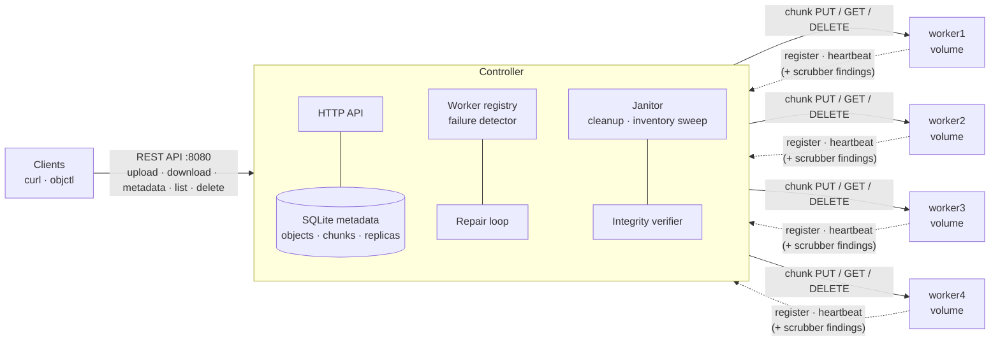

# Mini Distributed Object Store

A small, S3-style distributed object store written in Go. Objects are split
into 1 MB chunks, every chunk is stored on **two different workers**, and a
single controller keeps the metadata, notices failed workers, and repairs
lost or corrupted data automatically. The whole cluster (1 controller,
4 workers, a client) runs on one machine with Docker Compose.

> **Status: all phases (0–11) implemented and tested.** Every endpoint and
> every required demonstration of the
> [specification](docs/reference/Mini_Distributed_Cloud_Object_Store.pdf)
> works, and `./scripts/demo.sh` shows all of them in about two minutes.
> Phase 11 (packaging) is awaiting the owner's review.

## See it working in two minutes

You need **Docker** with Docker Compose v2 (Docker Desktop on Windows and
macOS) and a **bash** shell (on Windows: Git Bash). Go is only needed to run
the tests.

```bash
git clone <this repository> mini-object-store
cd mini-object-store
./scripts/demo.sh
```

The script builds the image, starts the cluster, and walks through the
specification's required demonstrations, printing each command it runs and a
✔ line for each result:

| # | Demonstration | What you see |
| --- | --- | --- |
| 1 | Object storage | A 5.5 MB upload is downloaded again and is byte-identical |
| 2 | Chunking and distribution | 6 chunks (5 × 1 MB + 0.5 MB) and how many land on each worker |
| 3 | Replication | Each chunk on exactly 2 workers; the two files shown on two volumes |
| 4 | Metadata | Custom metadata given at upload, read back, and changed with PATCH (no re-upload) |
| 5 | Worker failure | `docker stop worker2`: still downloadable; after the grace period the lost copies are re-created on the other workers; `docker start worker2`: back to exactly 2 copies per chunk |
| 6 | Data integrity | A damaged copy is never returned and is repaired; silent damage is found by the background scrubber with no download; with both copies damaged the object is refused (503), never returned wrong |

`DEMO_PAUSE=1 ./scripts/demo.sh` waits for Enter before each step, for
presenting. The demo starts the cluster with shortened timings (failure
detection in 5 s, repair after 15 s) so it fits in a few minutes; the
defaults are 10 s and 30 s. It leaves the cluster running.
**Presenting to someone new? Follow [`docs/DEMO_GUIDE.md`](docs/DEMO_GUIDE.md).**

> **Name or port clash?** Container names are global on a Docker host. If
> containers named `controller` or `worker1`…`worker4` already exist (another
> project), or port 8080 is taken, run
> `export OBJSTORE_CONTAINER_PREFIX=objstore- CONTROLLER_PORT=18080` first.
> The containers are then `objstore-worker2` etc. and the API is on port 18080.
> Never remove containers you did not create.

Stop the cluster with `docker compose down` (keeps the data) or
`docker compose down -v` (deletes all stored data).

## How it works



- **Upload.** The controller reads the upload as a stream, cuts it into
  1,000,000-byte chunks, and sends each chunk to **two different live
  workers** in parallel (a few chunks in flight at once). Each worker checks
  the chunk's SHA-256 and writes it atomically (temp file, fsync, rename).
  The object becomes visible only when every chunk has two confirmed copies,
  in a single database transaction. Anything that fails part-way is cleaned
  up; a half-written object is never visible.
- **Download.** Chunks are fetched in order, each from one of its copies, and
  checked against the controller's own SHA-256 before a byte is sent. A bad
  or unreachable copy is skipped and the other one used; the bad copy is
  marked for repair.
- **Metadata** lives only in the controller's database: custom string
  key/value pairs, changeable with PATCH (optional `If-Match` for safe
  concurrent edits). Listing is paginated.
- **Failure detection.** Workers send a heartbeat every 3 s. A worker silent
  for 10 s is **DEAD**: it gets no new data and reads avoid it. A returning
  worker re-registers with a list of the chunks it holds, which the
  controller reconciles before using it again.
- **Self-healing.** After a worker has been dead for 30 s (so a quick restart
  costs nothing), every chunk that lost a copy is copied from its surviving
  copy to another worker, most endangered first. When the worker returns,
  its now-redundant copies are deleted, so every chunk ends with exactly two.
- **Integrity**, in layers: checksums on every write, every read, and every
  repair copy; a background **scrubber** on each worker that re-reads its
  files slowly and reports damage (confirmed by the controller before
  anything changes); and a periodic **inventory sweep** that finds missing
  files and leftovers. Damaged copies are rewritten in place from a good copy.
- **Crash safety.** Every write is recorded before it starts, and every
  cleanup is a durable to-do entry, so a crash of the controller, a worker,
  or a client at any point leaves nothing visible and nothing behind once
  the system restarts.
- **Self-check.** `GET /admin/audit` checks the correctness invariants
  (complete objects, correct sizes, no duplicate copies, listing correctness,
  two copies per chunk, no stray files) against the live system.

More: [architecture](docs/ARCHITECTURE.md), [API reference](docs/API.md), the
[original design](docs/reference/Object_Store_Architecture.md), and every
decision with its reasons in the [decision log](docs/DECISIONS.md).

## Using it by hand

With the cluster running (`docker compose up -d --build`; use port 18080 if
you set `CONTROLLER_PORT`):

```bash
URL=http://localhost:8080
curl -s $URL/cluster                                   # workers, states, storage and repair totals
head -c 5500000 /dev/urandom > demo.bin
curl -s -F 'metadata={"owner":"alice"}' -F file=@demo.bin $URL/api/v1/objects
ID=<object_id from the response>
curl -s -o copy.bin $URL/api/v1/objects/$ID && cmp demo.bin copy.bin && echo identical
curl -s $URL/api/v1/objects/$ID/metadata               # metadata + chunk map (which workers hold each chunk)
curl -s -X PATCH -d '{"owner":"bob","tag":"x"}' $URL/api/v1/objects/$ID/metadata
curl -s "$URL/api/v1/objects?limit=10"                 # list (paginated)
curl -s $URL/admin/audit                               # invariants: "ok":true,"steady_state":true
curl -s -X DELETE $URL/api/v1/objects/$ID              # 204, then GET → 404
```

The `objctl` client runs in its own container (the spec's "client"):

```bash
docker compose --profile tools run --rm client list
docker compose --profile tools run --rm client chunks $ID   # table: each chunk and where its copies are
docker compose --profile tools run --rm client patch $ID owner=carol
docker compose --profile tools run --rm client cluster
docker compose --profile tools run --rm client audit
```

Failure by hand, as in the specification:

```bash
docker stop worker2       # ~10 s: DEAD in /cluster; downloads still work
                          # ~40 s: lost copies re-created; audit "steady_state":true
docker start worker2      # ALIVE again; its redundant copies are deleted
docker exec worker3 sh -c 'printf GARBAGE >> /data/chunks/<chunk_id>'   # corrupt a copy
```

Every endpoint, status code, and error is in [`docs/API.md`](docs/API.md);
step-by-step checks with expected output are in
[`docs/RUN_AND_TEST.md`](docs/RUN_AND_TEST.md).

## Configuration

Everything is an environment variable with a default; the full list with
explanations is [`.env.example`](.env.example). The most useful:

| Variable | Default | Meaning |
| --- | --- | --- |
| `CONTROLLER_PORT` | `8080` | Host port of the API (bound to 127.0.0.1) |
| `OBJSTORE_CONTAINER_PREFIX` | empty | Prefix for container names, to avoid clashes |
| `CHUNK_SIZE` | `1000000` | Chunk size in bytes (1 MB, as the spec says) |
| `REPLICATION_FACTOR` | `2` | Copies per chunk |
| `HEARTBEAT_INTERVAL` / `DEAD_AFTER` | `3s` / `10s` | Worker liveness |
| `REPAIR_GRACE` | `30s` | How long a dead worker may come back before its data is re-copied |
| `SCRUB_INTERVAL` | `10m` | Time between background integrity passes on each worker |
| `INVENTORY_SWEEP_INTERVAL` | `5m` | Time between missing-file / leftover-file sweeps |

## Testing

```bash
go test ./...                                   # unit + in-process cluster tests (~1 min)
go test -tags e2e -count=1 ./test/e2e/...       # real Docker Compose cluster (~4 min)
go vet ./... && gofmt -l . && go tool staticcheck ./...
```

The tests cover every failure scenario of the design: workers stopped or
killed mid-write, controller killed mid-upload, client disconnects, corrupt
and missing files, both copies lost, concurrent uploads, edits, and deletes
while a worker dies and returns. The race detector, benchmarks, and chaos
scripts are described in [`docs/RUN_AND_TEST.md`](docs/RUN_AND_TEST.md);
measured throughput, failure-detection and repair times are in
[`docs/EVALUATION.md`](docs/EVALUATION.md) (for example: 100 MB uploads at
≈ 90 MB/s, downloads at ≈ 165 MB/s; a lost worker's data fully re-replicated
41 s after it stopped, with default timings).

## Trade-offs and limitations

- **One controller** holds the metadata: it is a single point of failure
  (its database survives restarts, and workers re-register automatically),
  and all data passes through it, which caps throughput.
- **Two copies** survive one failure at a time; losing both workers of a
  chunk before repair loses that chunk (reported, never returned wrong).
- Writes are synchronous to both copies (safer, slower), objects are
  immutable (metadata is editable, data is replaced by re-uploading), and
  there is no authentication: the API is bound to localhost.
- Placement is random among live workers with free space.

Details and alternatives: [`docs/ARCHITECTURE.md` §14](docs/ARCHITECTURE.md#14-trade-offs-and-limitations).

## Technology

Go 1.27 standard library (`net/http`, `log/slog`), SQLite through the pure-Go
`modernc.org/sqlite` (no C compiler needed), `golang.org/x/sync`, Docker and
Docker Compose; `go vet`, `gofmt`, and `staticcheck` for static analysis.

## Repository layout

```
cmd/controller, cmd/worker, cmd/objctl   the three binaries (one Docker image)
internal/controller/
  api/          HTTP API: client endpoints, membership, /cluster, /admin/audit
  meta/         SQLite metadata store; reconciliation, sweep, audit, recovery
  upload/ download/   streaming write and read paths
  placement/    replica placement
  registry/     worker states, epochs, failure detector
  repair/       self-healing re-replication
  janitor/      cleanup, stale uploads, inventory sweep
  integrity/    cross-check of scrubber reports
  resync/       reconciliation of returning workers
  workerclient/ the only code that calls workers
  custommeta/   custom metadata validation
internal/worker/
  store/        atomic, checksummed chunk files
  server/       worker HTTP API
  agent/        register and heartbeat
  scrub/        background integrity scrubber
internal/{ids,config,wire,httpx,version}   shared packages
test/integration   in-process clusters with fault injection
test/e2e           Docker / Compose tests (build tag e2e)
scripts/           demo.sh, evaluation benchmarks and chaos script
docs/              architecture, API, run & test, demo guide, evaluation, decisions, log
```

## Documentation

| Document | For |
| --- | --- |
| [DEMO_GUIDE.md](docs/DEMO_GUIDE.md) | Presenting the project to someone seeing it for the first time |
| [ARCHITECTURE.md](docs/ARCHITECTURE.md) | How the system is built, and where it differs from the design |
| [API.md](docs/API.md) | Every endpoint, status code, and error |
| [RUN_AND_TEST.md](docs/RUN_AND_TEST.md) | Building, running, and verifying everything, step by step |
| [EVALUATION.md](docs/EVALUATION.md) | Measured performance, failure detection, and repair times |
| [VIVA_GUIDE.md](docs/VIVA_GUIDE.md) | Every feature and failure scenario mapped to a test and a command |
| [DECISIONS.md](docs/DECISIONS.md) | Every implementation decision and why |
| [IMPLEMENTATION_PLAN.md](docs/IMPLEMENTATION_PLAN.md) | Phase roadmap and status |
| [DEVELOPMENT_LOG.md](docs/DEVELOPMENT_LOG.md) | What was built and verified in each phase |
| [Specification](docs/reference/Mini_Distributed_Cloud_Object_Store.pdf) | The original assignment ([text](docs/reference/Mini_Distributed_Cloud_Object_Store.txt)) |

## Project status

| Phase | Theme | Status |
| --- | --- | --- |
| 0 | Setup and design lock-in | COMPLETED |
| 1 | Worker: durable chunk store over HTTP, in Docker | COMPLETED |
| 2 | Membership, failure detection, `SYNCING`, Compose cluster | COMPLETED |
| 3 | Write path: metadata DB, chunking, replication, atomic commit | COMPLETED |
| 4 | Read path: verified, in-order download with replica fallback | COMPLETED |
| 5 | Complete client API: metadata, PATCH, list, delete; `objctl` | COMPLETED |
| 6 | Degraded operation, inventory reconciliation, `/cluster` totals, audit | COMPLETED |
| 7 | Self-healing re-replication | COMPLETED |
| 8 | Data integrity: scrubber, controller cross-check, corrupt repair | COMPLETED |
| 9 | Crash consistency: recovery, stale uploads, live inventory sweep, audit v2 | COMPLETED |
| 10 | Evaluation: benchmarks, chaos, invariant tests | COMPLETED |
| 11 | Packaging: one-command demo, final README, demo guide | COMPLETED (awaiting review) |

All decisions are settled, including the two confirmed by the owner: 1 MB =
1,000,000-byte chunks (DEC-005) and string-only custom metadata (DEC-013).
